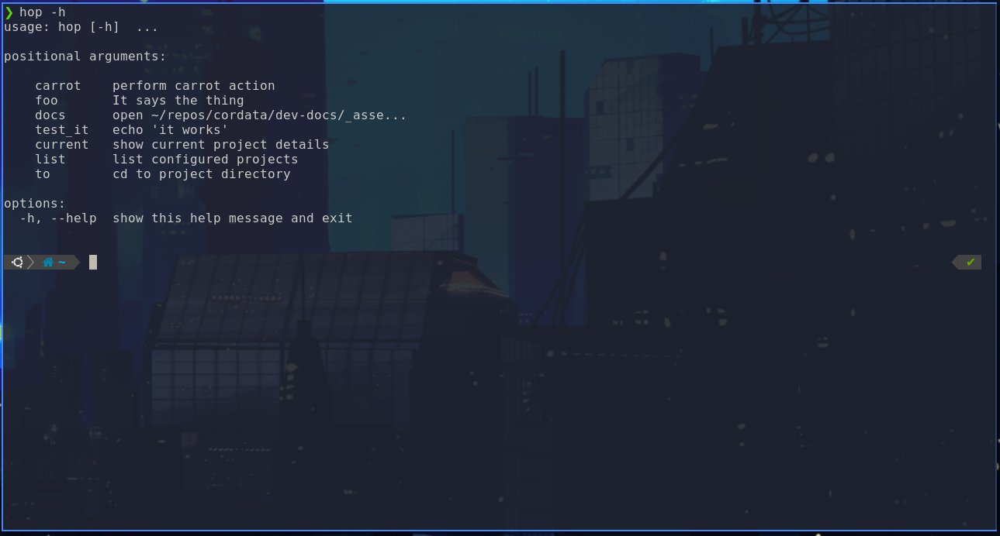

# Task Hopper
## The Configurable & Extendable CLI

### Create custom CLI commands and compose scripts all with one tool!

-   :fontawesome-solid-truck-fast:{ .lg .middle } __Quick to Set Up__

    ---

    Install [`mkdocs-material`](#) with [`pip`](#) and get up
    and running in minutes

    [:octicons-arrow-right-24: Getting started](#)

-   :fontawesome-solid-file-lines:{ .lg .middle } __Personalize w/ Config File__

    ---

    Create aliases and customize behavior within a .hoprc config file.

    [:octicons-arrow-right-24: Configuration](#)

-   :fontawesome-solid-carrot:{ .lg .middle } __Extendable with Carrots__

    ---

    Add new commands, tasks, or other functionality with Carrots (plugins).

    [:octicons-arrow-right-24: Carrots](#)

-   :material-scale-balance:{ .lg .middle } __Open Source, MIT__

    ---

    Task Hopper is licensed under MIT and available on GitHub

    [:octicons-arrow-right-24: License](#)

